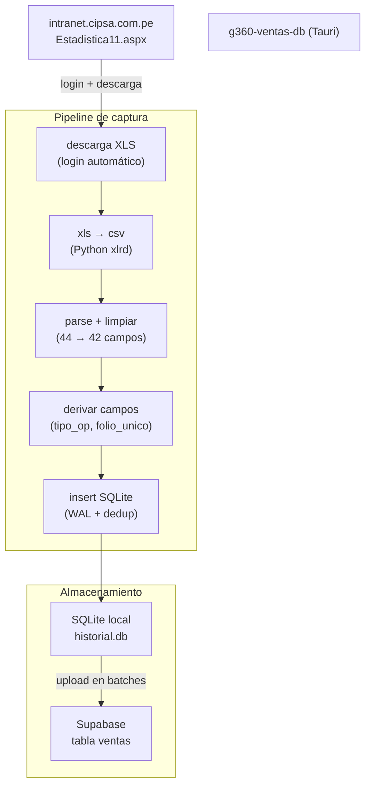
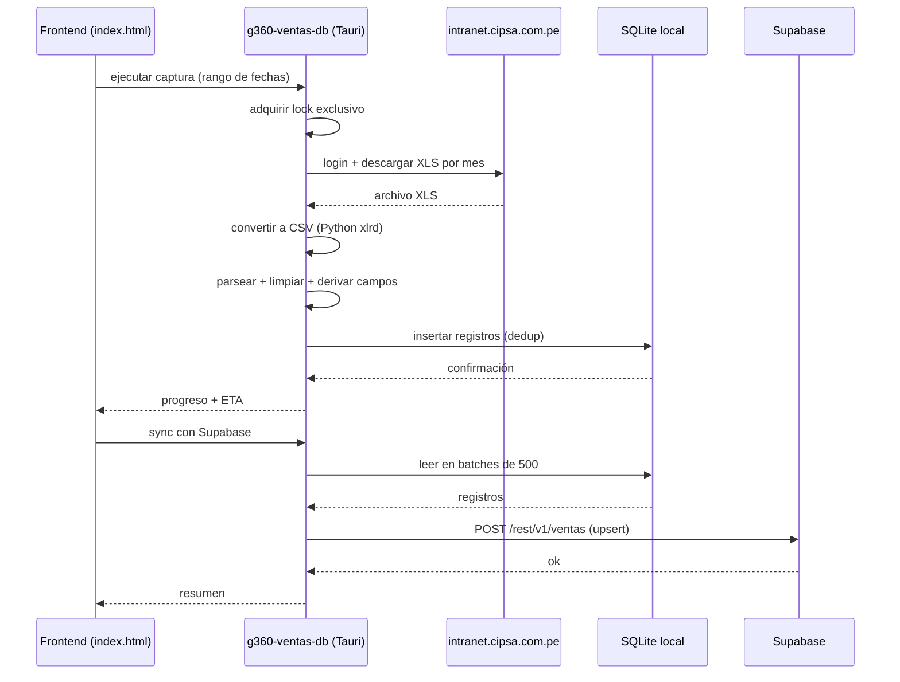
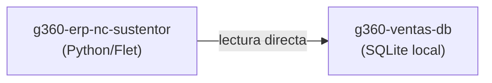

# g360-ventas-db

> Solución de datos orientada al procesamiento y generación de una base de datos derivada a partir de información corporativa de ventas, aislada de la fuente original y enfocada en el área de Consumo Masivo. App de escritorio (Tauri) que captura, limpia y normaliza en SQLite local y sincroniza con **Supabase** para CRM. Forma parte del ecosistema G360.

[](https://github.com)
[](https://github.com/carloscus/g360-cli)
[](https://www.rust-lang.org/)
[](https://tauri.app/)

## ¿Cómo está organizado el proyecto?



## Tabla de Contenidos

- [Descripción](#descripción)
- [Objetivo](#objetivo)
- [Arquitectura](#arquitectura)
- [Pipeline de captura](#pipeline-de-captura)
- [Esquema de datos](#esquema-de-datos)
- [Campos derivados](#campos-derivados)
- [Vistas para API de devoluciones](#vistas-para-api-de-devoluciones)
- [Vistas de análisis comparativo](#vistas-de-análisis-comparativo)
- [Guía rápida](#guía-rápida)
- [Interfaz de escritorio](#interfaz-de-escritorio)
- [Configuración](#configuración)
- [Retención de datos](#retención-de-datos)
- [API REST para downstream](#api-rest-para-downstream)
- [CLI](#cli)
- [Desarrollo](#desarrollo)
- [Protecciones](#protecciones)
- [Ecosistema G360](#ecosistema-g360)

---

## Descripción

Ventas DB genera una base derivada a partir de información corporativa de ventas, acotada al área de Consumo Masivo y aislada de la fuente original. Evita modificaciones sobre el origen, reduce el acoplamiento con otras áreas y facilita el tratamiento y análisis comercial en un ámbito controlado.

Opera bajo principio de mínimo privilegio: solo datos necesarios para el área, sin persistencia de credenciales en el repositorio y con control de acceso a nivel de tabla. Aplica buenas prácticas de estructuración y gestión, con enfoque en privacidad y tratamiento de información sensible. La app de escritorio descarga el reporte desde el intranet (Estadistica11.aspx), lo normaliza en SQLite local y lo sincroniza con Supabase para el CRM.

**Tipo**: Aplicación de escritorio (Tauri v2)  
**Runtime**: Rust 1.75+ / Tauri 2.x  
**Uso**: Equipo de Consumo Masivo, analistas y sistema CRM

---

## Objetivo

Construir una capa de datos derivada y aislada para el procesamiento y análisis de información de ventas de un área específica, utilizando como fuente información corporativa sin modificar el origen, facilitando un ámbito de trabajo desacoplado, gobernable y auditable.

---

## Arquitectura



---

## Pipeline de captura

```
1. Preflight      → verifica credenciales intranet + Chrome instalado
2. Lock           → handle exclusivo (evita capturas simultáneas)
3. Descarga       → por mes: Estadistica11.aspx → XLS
4. Conversión     → XLS → CSV (Python xlrd)
5. Parsing        → CSV → struct Venta (42 campos)
6. Derivación     → tipo_operacion, factura_ref, folio_unico
7. Inserción      → SQLite (WAL, dedup por mes)
8. Upload         → SQLite → Supabase (batches de 500)
```

### Smart sync

| Condición | Modo | Detalle |
|-----------|------|---------|
| Hueco ≤ 7 días | **Diario** | descarga día por día |
| Hueco > 7 días | **Mensual** | descarga por mes (más rápido) |

---

## Esquema de datos

Tabla `ventas` (SQLite local + Supabase). **42 columnas** efectivas (+ `id` y `capturado_en`).

| Grupo | Campos |
|-------|--------|
| **Producto** | `id_articulo`, `original_sku`, `nom_articulo`, `id_linea`, `nom_linea`, `id_grupo`, `nom_grupo`, `id_tipo`, `nom_tipo`, `id_familia`, `nom_familia` |
| **Cliente** | `id_cliente`, `doc_cliente` (RUC), `nom_cliente` |
| **Documento** | `tpo_doc`, `serie_doc`, `nro_doc`, `referencia`, `folio_unico` |
| **Montos** | `moneda`, `cantidad`, `soles`, `dolares`, `precio_unitario` |
| **Fechas** | `anho`, `mes`, `fecha_orig`, `fecha_ref`, `fecha_venc` |
| **Ubicación** | `cod_sucursal`, `nom_sucursal`, `departamento`, `provincia`, `distrito` |
| **Vendedor** | `id_vendedor`, `nom_vendedor` |
| **Pedido** | `id_pedido` |
| **Metadata** | `file_source`, `mes_ref`, `tipo_operacion`, `factura_ref_serie`, `factura_ref_nro` |

---

## Campos derivados

Calculados por el parser al capturar, para facilitar el cruce en el CRM:

| Campo | Cálculo | Ejemplo |
|-------|---------|---------|
| `tipo_operacion` | según `tpo_doc` + signo de `cantidad` | `venta`, `devolucion`, `ajuste_valor`, `nota_debito` |
| `factura_ref_serie` | parseado de `referencia` | `201` |
| `factura_ref_nro` | parseado de `referencia` | `199685` |
| `folio_unico` | `tpo_doc/serie_doc/nro_doc` | `F01/201/47967` |

> La referencia `F01/201-199685` en una NCR permite cruzar la **devolución** con la **factura** original (`serie_doc=201`, `nro_doc=199685`).

---

## Vistas para API de devoluciones

Se crean en Supabase (migración `supabase/migrations/20250828000003_vw_retornos.sql`) y se sincronizan localmente a SQLite para offline.

| Vista | Qué contiene | Uso |
|-------|--------------|-----|
| `vw_dim_articulo` | SKU, nombre, línea, grupo (agregado por `id_articulo`) | Catálogo consultable |
| `vw_dim_cliente` | Cliente ID, RUC, razón social | Lookup de clientes |
| `vw_nc_totales` | Suma de `cantidad_fae` y `soles` de NCs que cubren ≥99% de la factura | Cálculo de precio neto |
| `vw_nc_parciales` | NCs que no llegan al 99% (informativas, no afectan precio) | Alertas de negocio |
| `vw_facturas_disponibles` | Cada factura con saldo disponible y precio para devolución | Motor LIFO |

**Reglas de negocio aplicadas:**

- NC total = suma de `abs(cantidad_fae)` ≥ 99% de `cantidad_vendida` → reduce el precio base
- NC parcial = <99% → solo informativa, no altera precio
- Precio para devolución = `precio_unitario - (total_monto / total_fae)` cuando hay NC total
- Periodo = alerta si la factura es mayor a 3 años (`FUERA_PERIOD`)
- Moneda = todos los valores en Soles

Índices creados: `idx_retorno_cliente_sku`, `idx_retorno_folio`, `idx_retorno_ref`.

## Vistas de análisis comparativo

Vistas materializadas (`mv_venta_linea_sku_mes`) y vistas SQL para análisis de ventas, histórico de artículos y radar de recompra.

| Vista | Qué contiene | Uso |
|-------|--------------|-----|
| `vw_comparativo_ventas` | Ventas por artículo/mes con variación interanual y mensual (%) | Comparar desempeño de SKU |
| `vw_comparativo_linea` | Ventas por línea/mes con variación interanual y mensual (%) | Comparar desempeño de línea |
| `vw_historial_venta_cliente` | Historial de ventas por cliente+SKU con precio anterior | Verificar precio histórico |
| `vw_historial_articulo` | Histórico de artículo: vendido, devuelto, precio, cambios de nombre/línea | Análisis de producto |
| `vw_radar_recompra` | Cadencia de recompra por cliente+SKU, días silencio, estado oportunidad | Radar de oportunidades |
| `mv_venta_linea_sku_mes` | Materialized view: venta por línea+SKU+mes (pre-calculada) | Agregación rápida |

### Ejemplo: comparativo de un SKU

```bash
curl "https://tqdmoytaucnfrpaklprc.supabase.co/rest/v1/vw_comparativo_ventas?select=*&id_articulo=eq.02211&order=mes_ref.desc&limit=12" \
  -H "apikey: {ANON_KEY}" \
  -H "Authorization: Bearer {ANON_KEY}"
```

### Ejemplo: radar de recompra

```bash
curl "https://tqdmoytaucnfrpaklprc.supabase.co/rest/v1/vw_radar_recompra?select=*&id_cliente=eq.00068414&order=dias_silencio.desc&limit=20" \
  -H "apikey: {ANON_KEY}" \
  -H "Authorization: Bearer {ANON_KEY}"
```

---

## Guía rápida

### 1. Configurar credenciales

```bash
cp .env.example .env
```

```bash
G360_INTRANET_USER=usuario_demo
G360_INTRANET_PASS=password_demo
```

### 2. Capturar ventas (sección 1 · DB Local)

1. Abre la app Tauri (`G360 DB Ventas.exe`).
2. Define el rango (desde / hasta) y **⟳ Capturar rango** (o **↻ Sync última fecha** para incremental).
3. El pipeline descarga cada mes y lo inserta en SQLite. No toca Supabase.

### 3. Sincronizar con Supabase (sección 2)

- Click **🔄 Reconciliar ahora**: calcula el checksum por mes, y solo purga + re-sube (en batches de 500) los meses que cambiaron. Sin duplicados (`Prefer: return=minimal`, purga por lotes de ids antes de re-subir). Resumible + circuit breaker.

### 4. Flujo completo (sección 3)

- **▶ Ejecutar flujo completo** (usa el rango de la sección 1): descarga intranet → SQLite → reconcilia Supabase, en un solo paso.

### 5. Automatización diaria (Task Scheduler)

La app soporta modo headless para el Programador de Tareas de Windows:

```powershell
$Action = New-ScheduledTaskAction -Execute "C:\...\g360-db-ventas-tauri.exe" -Argument "--task-scheduler"
$Trigger = New-ScheduledTaskTrigger -Daily -At "15:00"
Register-ScheduledTask -TaskName "G360 Ventas Sync" -Action $Action -Trigger $Trigger -Force
```

Con `--task-scheduler` la app ejecuta el pipeline completo (captura día anterior → parseo → upload con verificación → checksums) y cierra automáticamente.

---

## Interfaz de escritorio

La UI está organizada en **3 secciones**:

### 1. DB Local
Métricas del SQLite local: **registros**, **desde/hasta**, **meses**, **documentos**, **tamaño BD**, **últ. captura / verificación** y **relación de folios NC/NDB** (total, asociadas a factura, huérfanas). Incluye la descarga por rango (desde → hasta), captura, sync, verificación/checksum, respaldo y el menú de acciones (importar, gestionar meses, calidad de datos, limpiar caché).

### 2. Supabase
Estado del sync + **desde/hasta**, **filas** y **documentos** en Supabase, con botón **🔄 Reconciliar ahora** (sincroniza mes por mes sin re-subir lo que no cambió).

> Los "documentos" de Supabase (`COUNT(DISTINCT folio_unico)`) usan la RPC `g360_ventas_stats()` (BLOQUE 8 de `supabase/RELOAD_CHECKLIST.sql`). Si no existe, se muestra "—" y el resto de métricas sigue funcionando. La RPC `g360_ventas_por_mes()` (BLOQUE 9) habilita el sembrado de reconciliación tras recrear la BD local.

### 3. Flujo automatizado
Un solo botón **▶ Ejecutar flujo completo** para un rango desde/hasta: descarga desde la intranet (si falta el mes) → crea/actualiza SQLite → reconcilia Supabase (verificando que no haya datos repetidos).

### Acciones y utilidades

| Elemento | Función |
|----------|---------|
| **⟳ Capturar rango** | descarga el rango desde la intranet → SQLite (no toca Supabase) |
| **↻ Sync última fecha** | captura incremental local (no sube) |
| **🔍 Verificar BD / 🔐 Checksum** | integridad y checksums mensuales |
| **📂 Compartir / respaldar BD** | abre la carpeta de datos |
| **⋯ más acciones** | Importar mes (XLS), Gestionar meses, Vista previa CSV, **📊 Monitor mensual**, 🚦 Calidad de datos, Limpiar caché |
| **⏹ detener** | abortar captura en curso |

### Monitor mensual (📊)

Tabla **mes · filas · unidades · total soles** (mismo filtro de líneas del uploader) para comparar contra la intranet. Botón **⬇ Exportar XLSX** → `data/export/monitor_<fecha>.xlsx` (XLSX real generado en Rust, sin dependencias externas).

### Modal de configuración

| Sección | Campo |
|---------|-------|
| **Intranet CIPSA** | usuario, clave (con estado configuradas/verificadas) |
| **Reporte** | generado por (responsable) |
| **Destino Supabase** | habilitado (switch), URL, anon key, service role key |
| **Comportamiento** | auto-sync al abrir, ventana Supabase (días), retención apps derivadas |
| **Líneas permitidas** | sufijos de línea de producto (avanzado) |
| **Operaciones avanzadas** | Reprocesar raw, Reconciliar, Recrear BD local |

---

## Configuración

### Variables de entorno

| Variable | Descripción |
|----------|-------------|
| `G360_INTRANET_USER` | Usuario del intranet |
| `G360_INTRANET_PASS` | Clave del intranet |

### config.json (datos de la app)

Almacenado en `%APPDATA%\g360-db-ventas\data\config.json`:

```json
{
  "supabase": {
    "url": "https://tu-proyecto.supabase.co",
    "key": "eyJ...anon key (solo lectura)",
    "service_role_key": "eyJ...service role (solo backend Rust)"
  },
  "intranet": {
    "user": "usuario_demo",
    "pass": "password_demo"
  },
  "generado_por": "Juan Perez",
  "allowed_lines": ["01", "02", "09", "11", "14"],
  "auto_sync": true,
  "app_retention_years": 3,
  "supabase_retention_years": 0,
  "supabase_retention_days": 1095,
  "auto_daily_capture": false,
  "capture_times": ["12:00", "20:00"],
  "last_supabase_sync": "2026-09-16T21:46:44Z"
}
```

> **Retenciones separadas**: `app_retention_years` (3) define la ventana activa para apps derivadas; `supabase_retention_years` (4) agrega un año de buffer para NC/ND cross-month que referencian facturas antiguas. La BD local conserva el historial completo.

### Modelo de seguridad

| Key | Uso | Permisos en Supabase |
|-----|-----|----------------------|
| **Anon key** (`supabase.key`) | Frontend Tauri + apps downstream (nc-sustentor, etc.) | **SELECT only** (RLS: `anon` → solo lectura) |
| **Service role key** (`supabase.service_role_key`) | Backend Rust (uploader) exclusivamente | **INSERT/UPDATE/DELETE** (bypass RLS) |

> La service role key **nunca se expone al frontend** ni se almacena en el repositorio. Se configura desde el modal de configuración → campo "Service role key".  
> Si no hay service role key configurado, el uploader cae al anon key (legado — sin restricción RLS).

**Migración de seguridad** (`20250828000004_rls_readonly_anon.sql`): restringe el rol `anon` a `SELECT` únicamente. Ejecutar desde Supabase Dashboard → SQL Editor.

---

## Retención de datos

| Escenario | Comportamiento |
|-----------|----------------|
| **Local** | historial completo (sin límite de años) + export RAW del ERP (todas las líneas) |
| **Supabase** | **ventana ROTATIVA** de `supabase_retention_days` (1095 = 3 años): cada subida inserta lo nuevo y elimina los meses con `mes_ref < cutoff` — un mes entra, un mes sale. Tras bajar la retención, la reconciliación ejecuta la limpieza fuera de ventana y luego conviene compactar (`VACUUM (ANALYZE)`, y `VACUUM FULL` si el tamaño reportado no baja) |
| **Apps derivadas** | ventana activa de `app_retention_years` (3 años) |
| **Líneas no permitidas** | raw-first: viven SOLO en la BD local; se filtran al subir (`config::with_line_filter`: allowlist + regla NC/ND por factura referenciada) |

> RAW-FIRST: el parser ya no filtra por línea — la BD local guarda el export completo del ERP, así que cambiar el allowlist o reprocesar no requiere re-capturar desde la intranet. El filtro obligatorio vive en el WHERE del uploader (`supabase_line_filter_sql`, fail-closed): sube líneas permitidas y NC/ND cuya factura referenciada (F01) tenga línea permitida (lookup global, cubre cross-mes). `stats_cache` se calcula con el mismo filtro para mantener el dashboard coherente con Supabase.
>
> **Capacidad (plan gratuito 500 MB)**: costo real medido ≈ 670 bytes/fila con índices. Monitoreo: `select * from vw_ventas_storage;` en el SQL Editor. Regla: <85% tranquilo, 85-95% planificar recorte, >95% riesgo de pausa.
>
> **Disk IO Budget (crítico en free tier)**: el plan gratuito tiene un presupuesto de I/O de disco; si se agota, el throughput cae a **5 MB/s** y las queries revientan con `57014` (statement timeout). Los Full Sync (purga de toda la ventana + re-subida) y `VACUUM FULL` son los mayores consumidores. Recomendaciones: preferir el **sync incremental** (`sync_smart`) sobre el Full Sync; usar `VACUUM ANALYZE` (no `VACUUM FULL`) para mantenimiento; espaciar las limpiezas. El app ya hace el chequeo de cambios de forma **local-first** y el display usa `count=planned` para no gastar I/O remoto. El presupuesto se repone en el ciclo de facturación.
>
> **Purga por lotes**: `purge_supabase_window`, `resync_stale_months` y `cleanup_supabase_retention` borran por lotes de 500 `id` (`id=in.(...)`) en lugar de un DELETE mensual, para no exceder el `statement_timeout` de PostgREST.
>
> Tras un Full Sync grande, el bloat se limpia solo con autovacuum; **NO** ejecutar `VACUUM FULL` (consume mucho I/O). Tras cualquier recreación de la tabla, re-aplicar RLS + índices con `supabase/RELOAD_CHECKLIST.sql`.

---

## Sincronización con Supabase

El local es la **fuente de verdad** y Supabase un **suscriptor opcional**. Hay **dos modos**, ninguno purga la ventana completa:

### Modo incremental por día (`sync_incremental`) — día a día
Usado por **Sync última fecha**, **Flujo completo** y el pipeline diario. En vez de tocar el mes entero, solo toca **los días en `[desde, hasta]`**:
- Purga en Supabase **solo los días capturados** (`mes_ref` + `fecha_orig >= desde`, por lotes de 500 `id`) y re-sube las filas locales de esos días.
- **Sin duplicados**: siempre purga esos días antes de re-subir.
- **Menos bloat**: un día (~cientos de filas) en vez de un mes (~miles) — evita que el uso vuelva a crecer por churn.
- Clampa `desde` al inicio de la ventana de retención y ejecuta `cleanup_supabase_retention` (fuera de ventana). Tras sincronizar, marca el mes como sincronizado en `sync_months`.

### Modo reconciliación por mes (`reconcile_supabase`) — correcciones
Usado por el botón **"🔄 Reconciliar"** (y full syncs). Compara **checksums por mes** de las filas elegibles y solo purga + re-sube los meses que cambiaron:
- Tabla local `sync_months(mes_ref, local_checksum, remote_checksum, estado, intentos, ultimo_error)`.
- **Resumible** + **circuit breaker** (corta tras 3 meses fallidos consecutivos).
- Ideal cuando un **re-parseo / cambio de allowlist** afecta meses enteros.

> **Evitar duplicados y re-ocupación**: ambos modos **purgan antes de subir** (no duplican) y el **tamaño queda acotado** por la ventana rotativa (`supabase_retention_days`). El modo por día minimiza el bloat diario; para el bloat residual, compactar de vez en cuando (`VACUUM (ANALYZE)`, y `VACUUM FULL` si el tamaño reportado no baja).

### Modo solo-local (`supabase_enabled`)

En Configuración → **Destino Supabase** hay un switch **"Supabase habilitado"**. Si se desactiva, la app es **100% local**: captura, parseo, dims y checksums en SQLite; ninguna operación toca Supabase.

### Flujo automático al abrir (`sync_smart`)

1. Captura desde la última fecha local.
2. Si Supabase está habilitado y configurado → `sync_incremental` (por día).
3. Si no → solo captura local y termina.

No hace full-scans remotos: los checksums son locales y el display de Supabase usa `count=planned` (estimador del planner).

---

## Base canónica para otras apps

`historial.db` es la **base canónica** de este proyecto. Otras apps consumen una
**instantánea** en vez del SQLite en caliente: **⋯ más acciones → 🗄 Exportar base
canónica** genera `base_canonica_<fecha>.db` (copia autocontenida vía `VACUUM INTO`)
+ `base_canonica_<fecha>.manifest.json` (versiones, cobertura y checksums mensuales).
La app consumidora importa el `.db` a su **propia copia**, valida contra el manifiesto
y trabaja aislada (tablas/vistas con prefijo propio). No hay sync bidireccional.

Protocolo completo, manifiesto, llaves de join y reglas: [`docs/base-canonica-consumo.md`](docs/base-canonica-consumo.md).

### Cartucho (seed para clientes offline)

El motor genera **cartuchos** (`.db` + `.manifest.json`) que se distribuyen a clientes
offline por USB o red compartida. Cada cartucho incluye:

- **SHA256** del archivo para verificación de integridad en transporte
- **`contracto_version`** / **`dim_schema_version`** / **`normalizacion_version`** — el consumidor bloquea si no coincide
- **`day_checksums`** y **`mes_checksums`** — baseline para detectar corrupción
- **`data_quality`** — estado de calidad (excellent / good / needs_review)
- **`attributes_applied`** — normalizaciones ejecutadas (id_pedido, mes_ref, fechas)

**Uso desde CLI:**

```powershell
# Generar cartucho inicial desde una BD existente
.\target\release\build_initial_cartucho.exe --db .\data\historial.db --output .\exports\base_canonica

# Verificar integridad de un cartucho
.\target\release\compare_checksums.exe --db .\exports\base_canonica.db --output check.json

# Comparar dos cartuchos (offline)
.\target\release\compare_checksums.exe --db cartucho1.db --output c1.json
.\target\release\compare_checksums.exe --db cartucho2.db --output c2.json
diff c1.json c2.json
```

**Flujo del cliente offline:**
1. Recibe `.db` + `.manifest.json` por USB/red
2. Copia a su directorio de datos
3. Verifica SHA256 (opcional)
4. Inicia app → `init_pool()` detecta versiones automáticamente
5. `check_contract_version()` bloquea si la versión no es compatible

> **Versión de contrato:** `CONTRACTO_VERSION = 4`. Si se bumpa, los consumidores
> existentes bloquean hasta actualizarse. El frontend muestra una alerta en la
> sección "DB Local" si detecta mismatch.

---

## Auditoría e integridad

La app incluye un sistema de verificación de datos accesible desde **⋯ más acciones**:

| Botón / Comando | Función |
|-----------------|---------|
| **🔍 Verificar Integridad** (`verify_integrity`) | detecta duplicados por `(folio_unico, id_articulo)`, folios huérfanos y meses faltantes |
| **🔐 Calcular Checksums** (`calculate_checksums`) | hash mensual por `(filas, soles, dolares)` — detecta cambios no autorizados |
| **🚦 Calidad de datos** (`get_data_quality`) | reporte por severidad: **críticos** (campos requeridos vacíos, fechas inválidas, `mes_ref` inconsistente), **warnings** (NC/NDB sin referencia, precio 0, ventas negativas, fechas futuras, huecos de meses) e **info** (NC/NDB huérfanas, duplicados legítimos) |
| **upload_dry_run** | preview de lo que se subiría (filas, totales, tamaño estimado) sin subir nada |
| **upload_all_with_verify** | reconcilia con verificación: solo avanza los meses cuyo conteo/checksum cuadra |

**Tablas de auditoría** (SQLite local):

| Tabla | Contenido |
|-------|-----------|
| `sync_log` | cada sync: tipo, estado, filas solicitadas/subidas/limpiadas, duración, errores |
| `mes_checksums` | hash por mes con timestamp — baseline para detectar corrupción |
| `sync_months` | estado de reconciliación por mes (local vs remoto, intentos, último error) |
| `audit_log` | trazabilidad de operaciones DML |

**Seguros contra datos corruptos de la fuente (intranet)**:

| Seguro | Qué previene |
|--------|--------------|
| **Validación de headers** | si el export del intranet cambia de formato (falta `ID_ARTICULO`/`ID_CLIENTE`/`FECHA_ORIG`/`TPO_DOC`/`SERIE_DOC`/`NRO_DOC`) → **aborta** con mensaje accionable |
| **Fechas inválidas** | si alguna fila trae `fecha_orig` inválida → **no se reemplaza el mes** (aborta la carga) |
| **Guard de reemplazo** | si las filas nuevas de un mes son <50% de las existentes → **no se borra el mes** (posible descarga truncada) |
| **Insert vacío** | si el parseo de un mes/día da 0 filas → **no se borra nada** (no-op) |
| **Validación pre-upload** | el uploader bloquea el sync con duplicados/folio nulo/negativos |

---

## API REST para downstream

Las vistas SQL expuestas en Supabase están disponibles vía PostgREST para consumo por apps externas.

### Endpoints disponibles

| Método | Ruta PostgREST | Descripción |
|--------|----------------|-------------|
| GET | `/rest/v1/vw_dim_articulo?select=*&id_articulo=eq.{sku}` | Validar existencia de SKU |
| GET | `/rest/v1/vw_dim_cliente?select=*&id_cliente=eq.{id}` | Lookup de cliente |
| GET | `/rest/v1/vw_facturas_disponibles?id_cliente=eq.{id}&id_articulo=eq.{sku}&limit=50` | Facturas con saldo (LIFO) |
| GET | `/rest/v1/vw_nc_totales?serie_doc=eq.{serie}&nro_doc=eq.{nro}` | NC totales de una factura |
| GET | `/rest/v1/vw_nc_parciales?factura_ref_serie=eq.{serie}&factura_ref_nro=eq.{nro}` | NC parciales |
| GET | `/rest/v1/vw_comparativo_ventas?id_articulo=eq.{sku}&order=mes_ref.desc` | Variación interanual/mensual del SKU |
| GET | `/rest/v1/vw_comparativo_linea?id_linea=eq.{linea}&order=mes_ref.desc` | Variación de línea |
| GET | `/rest/v1/vw_historial_venta_cliente?id_cliente=eq.{id}&id_articulo=eq.{sku}` | Histórico de precio por cliente+SKU |
| GET | `/rest/v1/vw_historial_articulo?id_articulo=eq.{sku}&order=mes_ref.desc` | Histórico del artículo |
| GET | `/rest/v1/vw_radar_recompra?id_cliente=eq.{id}&order=dias_silencio.desc` | Radar de recompra |
| GET | `/rest/v1/mv_venta_linea_sku_mes?select=*&id_linea=eq.{linea}&order=mes_ref.desc` | Venta por línea+SKU+mes |

### Ejemplo: obtener facturas disponibles

```bash
curl "https://tqdmoytaucnfrpaklprc.supabase.co/rest/v1/vw_facturas_disponibles?select=*&id_cliente=eq.00068414&id_articulo=eq.02211&limit=50&order=fecha_orig.desc" \
  -H "apikey: {ANON_KEY}" \
  -H "Authorization: Bearer {ANON_KEY}"
```

### Ejemplo: historial de precios de un cliente+SKU

```bash
curl "https://tqdmoytaucnfrpaklprc.supabase.co/rest/v1/vw_historial_venta_cliente?select=*&id_cliente=eq.00068414&id_articulo=eq.02211&order=fecha_orig.desc&limit=20" \
  -H "apikey: {ANON_KEY}" \
  -H "Authorization: Bearer {ANON_KEY}"
```

### Auth

Todos los endpoints requieren headers:
```
apikey: {ANON_KEY}
Authorization: Bearer {ANON_KEY}
```

La clave anon está en `config.json` → `supabase.key` (o variables de entorno `SUPABASE_URL` / `SUPABASE_ANON_KEY`).

### Consumidores conocidos

- **g360-erp-nc-sustentor** — app Flet que consume SQLite local directamente (no usa Supabase)
- **g360-ventas-analisis** — consulta `vw_comparativo_ventas`, `vw_historial_venta_cliente` para dashboards comparativos
- **g360-ventas-radar** — consulta `vw_radar_recompra` para alertas de oportunidades
- Otros proyectos pueden consultar Supabase directamente por PostgREST o SQLite local

---

## CLI

Binarios en `dist/` (o `cargo run --bin <nombre>`):

```bash
upload.exe    <rango>            # reconciliación Supabase (mes por mes)
recapture.exe <desde> <hasta>    # re-captura un rango desde la intranet (pipeline completo)
reparse.exe                      # re-parsea los CSV de raw/ -> SQLite (sin intranet)
importxls.exe <YYYY-MM> <xls>    # importa un XLS mensual manual (reemplaza el mes)
query.exe                        # consulta la BD
```

---

## Desarrollo

```bash
# Compilar binarios
cargo build --release

# Compilar la app Tauri (frontend en frontend/dist)
cargo tauri build

# Modo desarrollo
cargo tauri dev
```

### Estructura

```
src/
├── browser/captor.rs      # login + descarga XLS (headless Chrome)
├── processor/             # xls→csv, parsing, derivación, upload
├── db/                    # schema, writer, consultas
├── capture.rs             # pipeline principal + lock RAII
└── config.rs              # .env, config.json, líneas permitidas
src-tauri/
└── src/main.rs            # comandos Tauri (invoke_handler)
frontend/
└── index.html             # interfaz estática
```

---

## Rendimiento local (SQLite)

El local es la fuente de verdad y está optimizado para BD de ~2.8M filas:

| Medida | Detalle |
|--------|---------|
| **PRAGMAs** | `synchronous=NORMAL`, `temp_store=MEMORY`, `cache_size=64MB`, `mmap_size=256MB`, `wal_autocheckpoint`, `journal_size_limit` |
| **Índices depurados** | se eliminaron 5 redundantes (`idx_venta_linea_exact`==`idx_venta_linea`, `idx_retorno_ref`==`idx_venta_fact_ref`, prefijos `idx_venta_doc_cliente`/`idx_venta_fecha`, y `idx_venta_linea_sufijo` de formato viejo). Quedan 16 → menos escritura por INSERT |
| **Insert en bloque** | `insert_ventas` usa multi-row (`QueryBuilder`, chunks de 400) en vez de 1 statement por fila |
| **`stats_por_mes`** | agregado mensual precomputado (mismo filtro de líneas del uploader); el dashboard lo lee en vez de un `GROUP BY` en vivo |
| **`analyze_db`** | `ANALYZE` + `PRAGMA optimize` tras cada captura para que el planner elija buenos planes |
| **Dims** | las tablas `dim_*`/`fact_venta_mes` son cache: se reconstruyen bajo demanda (export) y los consumidores online usan las vistas `vw_dim_*` (siempre vivas) |
| **Descarga** | `build_pending` omite meses ya completos en `raw/` y la captura usa N workers en paralelo |

Resultado medido en la BD real (2.8M filas): **2.64 GB → 2.42 GB** tras dropear índices redundantes + `VACUUM` (−225 MB), y estadísticas del planner al día.

> `VACUUM` es **local** (barato y seguro en SQLite); es distinto de `VACUUM FULL` en Supabase, que NO se debe usar por el Disk IO Budget.

---

## Protecciones

| Capa | Qué hace | Qué previene |
|------|----------|--------------|
| **Lock exclusivo** | handle `share_mode=0` durante captura | Capturas simultáneas |
| **RAII guard** | `LockGuard` libera el lock al salir de scope | Lock huérfano |
| **Abort flag** | `AtomicBool` detiene el loop | Captura infinita |
| **Dedup por línea** | elimina duplicados por `(folio_unico, id_articulo)` | Registros repetidos (preserva facturas multi-línea) |
| **Dedup client-side upload** | filtro por `(folio_unico, id_articulo)` en cada batch | Duplicados en Supabase |
| **WAL mode** | lectura/escritura concurrente | Bloques de UI |
| **Smart retry** | 3 intentos + split 2/4/10 partes + día-a-día | Descargas fallidas |
| **Batch upload** | 500 registros por request | OOM / límite de Supabase |
| **parse_f64 contexto** | `is_quantity` distingue cantidades de montos | Corrupción de montos |
| **Filtro retención en SELECT** | `WHERE mes_ref >= cutoff` antes de subir | Exceso de cuota Supabase |
| **Validación pre-upload** | bloquea sync con duplicados/nulos/negativos | Subir data corrupta |
| **Verificación post-upload** | compara conteo enviado vs recibido; marker solo avanza si coincide | Syncs incrementales rotos |
| **Pool SQLite 32 conexiones** | `max_connections(32)` con `idle_timeout(60s)` | Pool agotado en syncs grandes |
| **Reconciliación por mes** | solo meses con checksum local != remoto (`sync_months`) | Purga de ventana completa / agotar Disk IO Budget |
| **Circuit breaker** | corta tras 3 meses fallidos consecutivos y reanuda después | Martillar Supabase throttled / abortar todo |
| **Chequeo local-first** | `sync_smart` decide con SQLite, sin full-scan remoto | Gastar I/O remoto en cada apertura |
| **Modo solo-local** | `supabase_enabled=false` desactiva todo contacto con Supabase | Dependencia forzada de Supabase |
| **VACUUM FULL post-sync** | ejecutar `VACUUM ANALYZE public.ventas;` (no FULL) | Bloat de dead tuples en Supabase |

---

## Ecosistema G360

Este proyecto forma parte del ecosistema **G360** para apoyo CRM y gestión de datos en CIPSA.

### Herramientas relacionadas

- **[g360-cli](https://github.com/carloscus/g360-cli)** — CLI para inicializar proyectos G360
- **[g360-master-data](https://github.com/carloscus/g360-master-data)** — Catálogo maestro de productos
- **[g360-stock-api](https://github.com/carloscus/g360-stock-api)** — Backend de datos de stock
- **[g360-stock-reporter-lit](https://github.com/carloscus/g360-stock-reporter-lit)** — Frontend PWA de stock
- **[g360-erp-nc-sustentor](https://github.com/carloscus/g360_NC_sustentor)** — App de sustento de Notas de Crédito (consume SQLite local)



---

## Licencia

Proyecto interno del ecosistema **G360 - CIPSA**.

---

**Marca**: G360 · Microherramientas para apoyo CRM y datos en CIPSA  
**Isotipo**: 3 puntos verticales paralelos (gris-verde-gris) + chevron `>`  
**Signature**: G360 by ccusi  
**Powered by**: [g360-signature](https://github.com/carloscus/g360-signature)

---

## Cambios recientes (oct-2026)

- **Menos I/O en Supabase**: el chequeo mensual del resync ya no usa `count=exact`
  (un full-count por mes); la cobertura del dashboard se cachea 5 min por sesión
  (`refreshSupabaseCoverage`, con refresco forzado tras reconciliar/sync); el
  borrado de retención subió a batches de 2000 con `order=id`.
- **Fechas en UI**: display en `dd/mm/aaaa` (`fmtFecha()` en `index.html`); el
  proceso sigue en ISO (`fecha_orig` rechaza el archivo si hay fechas inválidas).